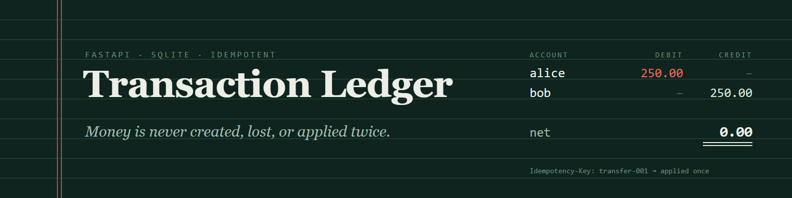

# Transaction Ledger API

A small HTTP service that keeps account balances and records every movement of money
between accounts. It is built so that **money is never created, lost, or applied twice**,
even when requests are retried or arrive at the same moment.

- **FastAPI** + **SQLite** (raw SQL, no ORM), Python 3.11+
- Money is stored as **integer minor units** (e.g. cents), never floats
- **Idempotent** transaction creation via the `Idempotency-Key` header
- **Atomic**: every transaction is applied in a single database transaction
- Cursor-based pagination
- Typed end to end (`mypy --strict`), linted with `ruff`, tested with `pytest`

## Run it

### Locally

```bash
python -m venv .venv
source .venv/bin/activate          # Windows: .venv\Scripts\activate
pip install -e ".[dev]"

uvicorn ledger.api:app --reload
```

The API is now on <http://127.0.0.1:8000>, with interactive docs at
<http://127.0.0.1:8000/docs>. The database is created on startup in
`./transaction_ledger.db`; set `LEDGER_DB_PATH` to put it somewhere else.

### With Docker

```bash
docker build -t ledger .
docker run --rm -p 8000:8000 -v ledger-data:/data ledger
```

The SQLite file lives on the `ledger-data` volume, so balances survive restarts.

## Try it

```bash
# create two accounts (they start at balance 0)
curl -X POST localhost:8000/accounts/ -H "Content-Type: application/json" -d '{"name": "Alice"}'
curl -X POST localhost:8000/accounts/ -H "Content-Type: application/json" -d '{"name": "Bob"}'

# deposit 10.00 (= 1000 cents) into account 1
curl -X POST localhost:8000/transactions/ \
  -H "Content-Type: application/json" -H "Idempotency-Key: deposit-001" \
  -d '{"transaction_type": "deposit", "account_destination_id": 1, "amount": 1000}'

# move 2.50 from account 1 to account 2
curl -X POST localhost:8000/transactions/ \
  -H "Content-Type: application/json" -H "Idempotency-Key: transfer-001" \
  -d '{"transaction_type": "transfer", "account_source_id": 1, "account_destination_id": 2, "amount": 250}'

curl localhost:8000/accounts/1                  # {"id":1,"name":"Alice","balance":750}
curl "localhost:8000/transactions/?account_id=1&limit=10"
```

## API

| Method | Path | Description |
|---|---|---|
| `POST` | `/accounts/` | Create an account. Body: `{"name": "..."}`. The server assigns the id; the balance starts at `0`. → `201` |
| `GET` | `/accounts/{id}` | An account and its current balance. → `200` / `404` |
| `POST` | `/transactions/` | Create a transaction. Requires the `Idempotency-Key` header. → `201` / `200` (replay) |
| `GET` | `/accounts/{id}/statement` | The account's transactions, newest first, each with its signed `change`, the `balance_after`, and the other party's name. Query: `limit`, `cursor` |
| `GET` | `/transactions/{id}` | One transaction. → `200` / `404` |
| `GET` | `/transactions/` | Newest-first page of transactions. Query: `account_id`, `limit` (1–100, default 10), `cursor` |

### Transactions

| `transaction_type` | `account_source_id` | `account_destination_id` | Effect |
|---|---|---|---|
| `deposit` | must be omitted | required | money enters the destination from outside |
| `withdraw` | required | must be omitted | money leaves the source to outside |
| `transfer` | required | required (different account) | money moves between two accounts |

`amount` is a positive integer in minor units, at most `1_000_000_000_000` per transaction. Ids must be
positive and fit a signed 64-bit integer; balances are capped at 2⁶³ − 1. Anything outside these ranges is
a `422`, never a server error, and a balance can never silently turn into a float.

Collection routes work with or without the trailing slash (`/transactions` and `/transactions/`), and
neither redirects.

### Status codes

| Code | When |
|---|---|
| `201` | Transaction created (or account created) |
| `200` | Idempotent replay: same key, same body. The original transaction is returned and nothing is applied again |
| `404` | Unknown account |
| `409` | Idempotency key reused with a **different** body |
| `422` | Invalid request: bad type, amount or id, missing/empty `Idempotency-Key`, wrong source/destination for the type, **insufficient funds**, or a credit that would push a balance past the maximum |
| `503` | The ledger was busy (another writer held the database lock past the timeout). Nothing was applied; retry with the **same** key. Sent with `Retry-After: 1` |

### Idempotency

Clients generate a unique key (a UUID works) once per logical operation and resend the same
key when they retry. If a response is lost, retrying is always safe:

- same key + same body → `200`, the original transaction, balances unchanged
- same key + different body → `409`
- a *failed* request (e.g. insufficient funds) does not consume its key

### Pagination

Results are newest first. The response is `{"items": [...], "next_cursor": 41}`. Pass
`next_cursor` back as `?cursor=41` to get the next page; `next_cursor` is `null` on the last
page. A non-integer or non-positive `cursor`, or a `limit` outside 1–100, is a `422`.

## How correctness is guaranteed

All money movement goes through `ledger.db.apply_transaction`, which runs in **one SQLite
transaction opened with `BEGIN IMMEDIATE`**:

1. look up the idempotency key (replay / conflict check)
2. check that both accounts exist
3. debit with `UPDATE accounts SET balance = balance - :amount WHERE id = :src AND balance >= :amount`
   — the balance check and the debit are a single statement
4. credit the destination
5. insert the transaction row
6. `COMMIT`

- `BEGIN IMMEDIATE` takes the write lock before step 1, so concurrent requests are
  serialised: two requests can't both read the same balance and both spend it, and two requests
  with the same key can't both pass the replay check.
- Any failure rolls the whole thing back, so there is never a half-applied transfer and never
  money moved without its transaction row (which would make a client's retry apply it twice).
- The schema backs this up even if application code has a bug: `CHECK (balance >= 0)`,
  `CHECK (amount > 0)`, `UNIQUE (idempotency_key)`, and foreign keys on both accounts.

## Account statements (SQL)

`GET /accounts/{id}/statement` is built from three SQL techniques, all in `ledger/db.py`:

- a **window function**, `SUM(change) OVER (ORDER BY id ROWS BETWEEN UNBOUNDED PRECEDING AND CURRENT ROW)`,
  gives the running balance after each transaction;
- a **`LEFT JOIN`** to `accounts` supplies the other party's name (null for deposits and withdrawals);
- the cursor filter and `LIMIT` are applied *after* the window, so `balance_after` is right on every page.
  (Cutting the page first would restart the running total at the top of each page.)

The query that finds an account's transactions is served by `idx_transactions_source` and
`idx_transactions_destination`. `ledger.db.explain_account_entries(id)` returns SQLite's query plan
(`SEARCH ... USING INDEX` is good, `SCAN` is a full table scan), and a test asserts the plan, and that it
changes to a scan when the indexes are dropped.

`python -m ledger.reconcile` checks the books with a join, `GROUP BY` and `HAVING`: total money held must
equal deposits minus withdrawals, and each account's balance must equal what its own transactions add up
to. Exit status `0` = consistent, `1` = mismatch (printed to stderr), `2` = could not run.

## Python client

`ledger_client` is a small client for the API (`pip install -e ".[client]"` pulls in `httpx`). It is also a
tour of three Python features, each tested:

```python
from ledger_client import LedgerClient, AsyncLedgerClient, TransferRequest

with LedgerClient("http://localhost:8000") as api:
    alice = api.create_account("Alice")
    api.create_transaction("deposit", 1000, destination_id=alice.id)

    for tx in api.iter_transactions(alice.id):  # a generator: pages are fetched lazily
        print(tx.id, tx.transaction_type, tx.amount)
```

- **Generator:** `iter_transactions` follows `next_cursor` and yields one transaction at a time. Nothing is
  requested until you iterate, and only one page is in memory however long the history is.
- **Decorator:** `retry_on_busy` (and `async_retry_on_busy`) retry a call on a `503`, honouring `Retry-After`
  and backing off exponentially. They are typed with `ParamSpec`, so a decorated function keeps its exact
  signature for mypy. The idempotency key is generated **once, before the first attempt**, so every retry
  reuses it and a retry can never apply a transfer twice. `create_account` has no key, so it is
  deliberately *not* retried.
- **async/await:** `AsyncLedgerClient.bulk_transfer(requests, concurrency=10)` runs many transfers at once
  with `asyncio.gather`, a semaphore capping how many are in flight. Each request carries its own key, so
  running the same batch twice applies nothing the second time.

## Operations

| File | What it is |
|---|---|
| `scripts/run_server.sh` | Starts the server and uses `trap` to forward `SIGTERM`/`SIGINT` to it, so it stops gracefully |
| `scripts/graceful_shutdown_demo.sh` | Stops the server mid-request with `SIGTERM` and with `SIGKILL` and shows the difference (Linux/macOS/WSL) |
| `scripts/load_test.sh` | `curl` + `xargs -P` fire parallel requests and check the promises hold: one key applied once, 200 concurrent withdrawals never overdraw |
| `scripts/analyze_logs.sh` | A `grep`/`sed`/`awk`/`sort | uniq -c` pipeline that summarises the JSON logs: events, rejection reasons, money applied |
| `deploy/ledger.service` | A hardened `systemd` unit (unprivileged dynamic user, read-only filesystem, state in `/var/lib/ledger`) |

What the graceful-shutdown demo shows: on `SIGTERM` the in-flight deposit still completes (`201`) and is
applied, new connections are refused, and the server exits with status `143` (128 + 15: uvicorn finishes its
work and re-raises the signal, which `systemd` treats as a clean stop). On `SIGKILL` the process dies at once,
the client gets no answer, and because the deposit never committed, nothing was applied.

The scripts are checked with `shellcheck` and run in CI. The unit file passed `systemd-analyze verify`, but it
has not been run under a real `systemd` here.

## Configuration

| Variable | Default | Meaning |
|---|---|---|
| `LEDGER_DB_PATH` | `transaction_ledger.db` | Where the SQLite file lives (`/data/ledger.db` in Docker) |
| `LEDGER_DB_TIMEOUT` | `10` | Seconds to wait for the write lock before answering `503` |
| `LEDGER_LOG_LEVEL` | `INFO` | Log level for the `ledger` loggers |

The schema is created on startup with `CREATE TABLE IF NOT EXISTS`, so an existing database file keeps its
old schema. If you have a development database from an earlier version, delete it so the newer constraints
(for example "a balance must be an integer") apply.

## Logging

Logs go to stderr as one JSON object per line:

```json
{"time": "...", "level": "INFO", "logger": "ledger.api", "event": "transaction_applied",
 "idempotency_key": "transfer-001", "tx_type": "transfer", "amount": 250,
 "source_id": 1, "destination_id": 2, "tx_id": 2}
```

Events: `transaction_applied`, `transaction_replayed`, `transaction_rejected` (with a `reason` such as
`insufficient_funds`, `account_not_found`, `idempotency_conflict`, `busy`), and `account_created`. The
idempotency key is the correlation id: search it to follow one logical request across retries.

## Development

```bash
pytest                       # tests
ruff check . && ruff format --check .
mypy                         # strict mode, configured in pyproject.toml
```

The suite includes concurrency tests (parallel withdrawals can never overdraw; parallel
requests with one key apply exactly once; opposing transfers don't deadlock or lose money)
and a crash-injection test (a failure after the balances change but before the row is written
leaves everything untouched).

CI (`.github/workflows/ci.yml`) runs on every push and pull request: lint, type checking and tests on
Python 3.11 and 3.13; `shellcheck`, the load test against a real server, `ledger.reconcile`, and the
graceful-shutdown demo on Linux; and a Docker image build with a smoke test.

## Project layout

```
src/ledger/
    db.py              schema, business rules, apply_transaction, statement + reconcile SQL
    api.py             FastAPI app: validation, error-to-status mapping, log events
    logging_config.py  JSON log formatter
    reconcile.py       `python -m ledger.reconcile` command
src/ledger_client/
    client.py          LedgerClient / AsyncLedgerClient (generators, bulk_transfer)
    retry.py           retry_on_busy / async_retry_on_busy decorators
    models.py          data types and typed errors
scripts/             shell tooling: server wrapper, load test, log analysis, shutdown demo
deploy/              systemd unit
tests/
    test_api.py                     behaviour through HTTP
    test_db.py                      atomicity, concurrency and constraint tests below the HTTP layer
    test_limits_and_resilience.py   int64 limits, lock timeouts, slashless routes, logging
    test_statement.py               statement (window function, join), query plans, reconcile
    test_client.py                  the client: retry decorator, lazy generator, async bulk transfer
```
